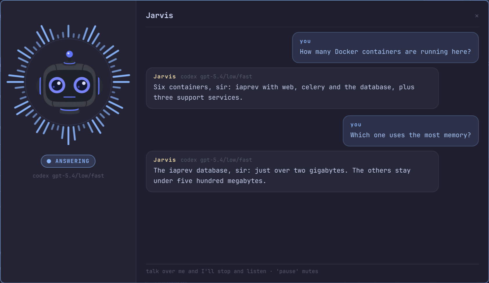
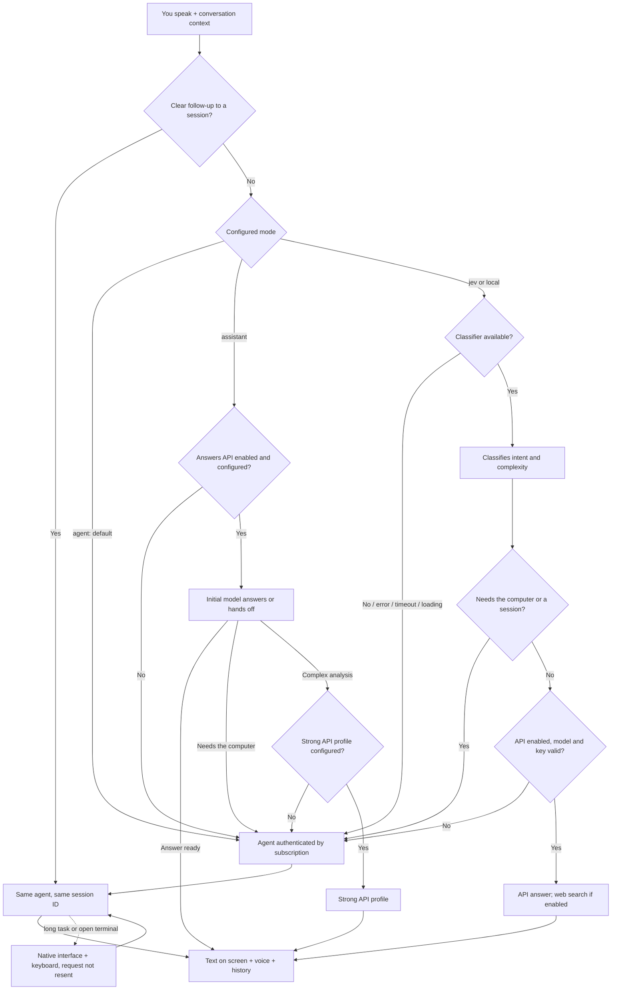

# Jarvis — talk to your computer

**Language:** English · [Português](README.pt-BR.md)

Say **“hey jarvis”**, ask a question or ask for something to be done. Jarvis transcribes your speech, answers out loud and keeps the conversation on screen. It also dictates into any app, lives in the Omarchy bar and can optionally drive a Picoh robot as its face.

**A Claude Code or Codex subscription is all the agent needs.** API keys, Jev and the local classifier are optional. New installs and existing configurations start in `routing_mode = "agent"`, with API answers disabled.



[Installation](#installation) · [Flow](#how-a-request-is-handled) · [Routing](#optional-routing) · [Configuration](#configuration) · [Terminal](#terminal-conversations) · [Dictation](#dictation-and-keybindings) · [Troubleshooting](#troubleshooting) · [What's new](CHANGELOG.md) · [Detailed reference](docs/reference.en.md)

## What you can do

| You say | Jarvis |
|---|---|
| “Explain the difference between RAM and storage.” | Answers through your subscription, or through the API you enabled. |
| “What's the weather tomorrow?” | Uses web search on an enabled API route, or hands it to the agent and the tools it is allowed to use. |
| “How many containers are running here?” | Hands it to the agent, within your computer-access setting. |
| “Open project X.” | Opens the project workspace: terminals, editor and browser. |
| “Pick up where you left off.” | Keeps the agent's identified session. |
| Press `Ctrl+Shift+K`, talk, press it again | Transcribes and pastes the text into the active app. |

Jarvis speaks English and Brazilian Portuguese. Capture uses voice activity detection and ends after silence; after each answer a follow-up window lets you keep talking without the wake word. Talking over an answer interrupts it. The voice is synthesized locally by Piper.

## Installation

You need Linux, a microphone, working audio and **one** authenticated agent: [Codex CLI](https://github.com/openai/codex) or [Claude Code](https://code.claude.com/docs/en/overview). Log that CLI in with your subscription before using Jarvis. The answers API is a separate, optional setup.

On Omarchy, add the panel to the bar:

```bash
omarchy plugin add https://github.com/Atzingen/hey-jarvis --enable
```

Click the icon and then **Install** to set up the voice service. Adding the plugin alone installs only the panel.

To install from the repository:

```bash
git clone https://github.com/Atzingen/hey-jarvis.git
cd hey-jarvis
bash install.sh
```

The installer prepares the voice Python environment, the speech-recognition models, the Piper voices, the scripts, the interface and the `voice-launcher.service` user unit. Python dependencies and voice downloads are pinned and verified. Outside Omarchy, install the system packages it lists and run it again.

**The regular install does not download the routing classifier, does not install its PyTorch and does not enable paid API answers.** A GPU speeds up the existing speech recognition; the optional classifier below runs on the CPU only.

Pick the agent and the language:

```bash
jarvis config set language en
jarvis config set quick_provider codex   # or claude
jarvis config
jarvis talk
```

The `jarvis config` screen saves and restarts the service when needed. After editing the TOML or using `config set` from a terminal, apply the change with:

```bash
systemctl --user restart voice-launcher.service
```

To update, pull the repository and run `bash install.sh --update`. It re-applies the files and dependencies of the regular install and restarts the service. With the Omarchy plugin, `omarchy plugin update atzingen.jarvis` updates the panel; to update the voice service as well, run `bash ~/.config/omarchy/plugins/atzingen.jarvis/install.sh --update`.

## How a request is handled



The diagram shows the decisions **before execution**. If a run has started and the connection drops, Jarvis keeps the ID and tries to query the same session. When it cannot confirm the result, it says so. **It never starts a second run to make up for a lost answer.**

Current information depends on available search tools. When the API route has no search, the request goes to the agent, and that agent's permissions still apply. `system_access = "off"` does not gain internet or computer access because of the router.

## Optional routing

| `routing_mode` | How it decides | What it needs | If the dependency is missing |
|---|---|---|---|
| **`agent` — default** | Sends straight to the chosen agent. | Codex **or** Claude, authenticated. | Reports the CLI/login problem; depends on no other vendor. |
| `assistant` | An initial API model answers directly or asks for a handoff. | Answers API explicitly enabled, a model and a key. | Uses the subscription agent. |
| `jev` | Jev classifies the request and its complexity. | A Jev/TypeSafe key. | Uses the subscription agent. |
| `local` | An optional classifier decides on the CPU. | Separate install of GLiNER2.5-multi-Decide. | Uses the agent while the classifier loads, fails or is missing. |

**Jev is a classifier.** It does not replace the model that answers, runs no commands and does not pick arbitrary model names. Without an enabled answers API, the classification still leads to the subscription agent. The same holds for the local classifier.

**`assistant` is the alternative without Jev:** the first API call can already produce the answer. If it needs computer tools, it hands the original request and the context to the agent. If a stronger API profile exists, it allows one escalation to it; there is no endless chain of classifications.

The `agent` mode skips the classifiers. It imports none of their modules, starts no local workers and calls neither Jev nor the answers API. Having an OpenAI key for transcription or narration **does not enable** the answers route.

The window shows which model handled **each answer**, with a discreet line for the path taken: for example `Jev → web search → API` or `Jev → computer → Agent · subscription`. While classifying, it shows that it is choosing the route. On a fallback, the same line records the failure and the handoff to the subscription. The history keeps the model and the route of every message, even when answers to long tasks arrive later.

### Model and effort

The router rates complexity as low, medium or high. Low and medium use the normal profile. High can use the strong profile you configure. Without a strong profile, the current one stays.

| Profile | Model/effort |
|---|---|
| Normal agent | `codex_model` + `codex_effort`, or `claude_quick_model` + `claude_quick_effort` |
| Strong agent | `agent_strong_model` + `agent_strong_effort`, **same provider** |
| Normal API | `api_model` + `api_effort` |
| Strong API | `api_strong_model` + `api_strong_effort` |

Use model identifiers and effort levels your account accepts. Jarvis never enables a paid model just because it found a key.

**“Think hard” and “pense bem” are ordinary text now.** These phrases no longer switch providers or enable a special mode. The former `deep_model`, `deep_effort`, `handoff_seconds_deep` and `narration_interval_deep` keys are still read from files and profiles so you can roll back, but they are out of the active settings.

## Configuration

Open `jarvis config`. The **Routing** group holds the mode, the optional API, the Jev key and the strong profiles. Keys live in `~/.config/jarvis/config.toml`, mode `0600`; secret fields are masked in the screen and in `config show`.

### Subscription only, no API keys

```toml
routing_mode = "agent"
api_provider = "none"
quick_provider = "codex"       # or "claude"
agent_session_mode = "auto"
```

This is the factory behaviour and the behaviour of older configurations that lack the new keys. Saved provider, model, effort and priority are kept.

### Jev decides; the subscription stays available

```toml
routing_mode = "jev"
api_provider = "none"
quick_provider = "codex"
```

Fill `jev_api_key` in the settings, or provide `JEV_API_KEY` in the environment of the Jarvis process. Without a valid key, the request goes to the agent. The configuration above **needs no OpenAI key**.

To allow direct API answers, also set:

```toml
api_provider = "openai"
api_model = "<a model available on your account>"
api_effort = ""                # empty: sends no effort parameter
api_web_search = true
```

Replace the model placeholder and fill `openai_api_key` in the settings, or make `OPENAI_API_KEY` available to the service. The opt-in that authorizes the route is `api_provider = "openai"` together with a filled model. A variable exported in a terminal does not reach a systemd service that is already running.

### Initial API model, no Jev

Use the API configuration above and change:

```toml
routing_mode = "assistant"
```

The initial model answers when it can solve the request with text or public search. Needing files, apps, commands or logged-in sites leads to the agent. `api_strong_model` is optional.

### Local classifier, CPU only

This option is **experimental**. It classifies the request; it does not generate the answer and does not make Jarvis a fully local assistant.

```bash
jarvis router install-local
jarvis config set routing_mode local
systemctl --user restart voice-launcher.service
```

The optional installer uses **Python 3.11 on Linux x86_64**, its own environment in `~/.local/share/jarvis/router-local`, hash-pinned dependencies and a pinned model revision. If needed, point it at the interpreter:

```bash
JARVIS_ROUTER_PYTHON=/path/to/python3.11 jarvis router install-local
```

The worker uses CPU PyTorch, blocks CUDA and loads only files already downloaded. Installation is explicit; speaking never triggers a download. While the model is cold, the request goes straight to the agent. After `local_router_idle_seconds` without use, the process exits and frees the memory.

See the [validation evidence](docs/routing-validation.md) for results, latency, disk use and the limits of the Portuguese evaluation. Classification mistakes never widen permissions: the API route does not execute textual actions.

### Personal context and fast mode

Create `~/.config/jarvis/contexto.md` (or point `context_file` at another file) with what the model should know about you: where your data lives, which tools to check. The text is appended to the system prompt when the model has computer access (`ask` or `full`) and goes to the provider with every request. It grants no permission; a missing file changes nothing. After you edit the file, the next conversation opens a new native session.

`codex_fast` (on by default) and `claude_fast` (off) ask each CLI for its fast mode: quicker answers that use more of the plan. Claude bills fast mode as extra usage and, without credits, falls back to normal speed.

### Limits and rollback

| Key | Default | Effect |
|---|---|---|
| `router_timeout_seconds` | `5.0` | Deadline for the Jev/local classification; then the agent is used. |
| `api_timeout_seconds` | `30.0` | Deadline for the API answer; an uncertain run is not repeated. |
| `local_router_idle_seconds` | `300` | Idle time before the classifier is unloaded. |
| `handoff_seconds_quick` | `45` | When to open the terminal for a long task. |
| `handoff_max_minutes` | `30` | Maximum duration of a turn; not the lifetime of an idle session. |
| `agent_session_mode` | `auto` | Native session when supported; `legacy` keeps the compatibility executor. |
| `agent_session_max_hours` | `12` | Maximum age of a native session; after that the next conversation opens a new one. |

To go back to the direct path and the previous executor:

```bash
jarvis config set routing_mode agent
jarvis config set api_provider none
jarvis config set agent_session_mode legacy
systemctl --user restart voice-launcher.service
```

Settings profiles remain available in the settings screen. The [full reference](docs/reference.en.md#settings) covers audio, voice, narration, interface and interruption options.

## Terminal conversations

Agent tasks can start in a persistent session. When a task takes long, or when you click **Open terminal**, Jarvis opens a normal terminal with the CLI's own interface and keyboard input. The window shows whether the request uses an interactive session or the compatibility mode.

- **Codex:** local app-server, subscription login and a TUI attached to the same ID. This local channel is not the paid answers API.
- **Claude:** native background session and `attach` to the exact ID, with a private tmux channel for voice. While the terminal is attached, the keyboard owns the input; **`Ctrl+B`, then `D`** detaches and releases queued voice requests. Closing the window also detaches.
- **Follow-ups:** new messages belong to the identified session, with directory and access policy checked. `--last` is never used, and opening a window never resends the original request.
- **Results in native sessions:** the real completion updates the history of the open conversation, even after the terminal was opened. The “continues in the terminal” notice is not recorded as a model answer. The legacy viewer keeps its previous behaviour.
- **Compatibility:** if the CLI lacks the required capabilities, the previous executor is chosen before the request is sent. Its progress viewer stays labelled as compatibility.

Last validation of the native integration: Claude Code `2.1.33x` (2026-11-25) and Codex CLI `0.159.2` (2026-10-02). Claude also needs `tmux`; the graphical terminal is Alacritty. Incompatible versions or capabilities keep the previous path.

**First use with Claude:** the background session opens in `~/.local/share/jarvis/workdir`, or in the request directory when `system_access = "full"` and that directory is not your home folder. Claude Code asks once whether to trust the folder: run `claude` in `~/.local/share/jarvis/workdir` and accept. Until then, Jarvis uses the compatibility mode.

The native session is replaced when the system prompt or the [context file](#personal-context-and-fast-mode) change, and after `agent_session_max_hours`; the old one is stopped if nothing is running in it. An answer that arrives after the long-task notice is spoken at the next pause, besides showing in the window.

A follow-up keeps the session's profile. With Claude, an independent request that selects another model or effort starts a new native session with the recent context; the previous session stays identifiable. With Codex, the profile can be applied per turn. When the request names a single real project in `dev_dir`, that directory is used; ambiguous names or links never select another directory automatically.

```bash
jarvis session status <jarvis-id>
jarvis session open <jarvis-id>
jarvis session stop <jarvis-id>
```

Records are kept private in `~/.local/share/jarvis/sessions`. The Jarvis ID shows in the conversation state and in `jarvis router status`. Ending a voice conversation with “end” unlinks the next conversation; a task already handed to the terminal keeps running there.

## Computer access

| `system_access` | Behaviour |
|---|---|
| **`ask` — default** | The model has no shell, read or write tool of its own. Commands, reads included, go through the consent tool and show the exact command. |
| `off` | No computer tools. Answers with the information it has. |
| `full` | The agent's own tools with the full-access options Jarvis already used. |

The router never changes this choice. Strong profiles gain no extra permissions either. In persistent sessions, “allow the rest of this question” belongs to the current turn and never becomes a permission for the whole conversation. Cancelling also interrupts an authorized command that is running.

API answers are text: markers such as `<<ABRIR_APP: ...>>` or `<<DORMIR>>` are not executed when they come from that route. More in [SECURITY.md](SECURITY.md).

## Dictation and keybindings

| Keybinding | Action |
|---|---|
| `Ctrl+Shift+J` | Calls Jarvis like the wake word; starts the service if needed. |
| `Ctrl+Shift+H` | Also calls Jarvis. |
| `Ctrl+Alt+Shift+J` | Turns only wake-word listening on/off. |
| `Ctrl+Shift+K` | Starts/stops dictation. |
| `Ctrl+Shift+L` | Dictation while the key is held. |
| `Esc`, during dictation review | Cancels the LLM review and delivers the original transcript. |

Add the bindings from [integrations/hypr-bindings.lua](integrations/hypr-bindings.lua) to your configuration. The installer never changes desktop keybindings by itself.

The original text is on the clipboard as soon as transcription ends, before the optional review. To send straight to an AI prompt without an extra cleanup pass:

```bash
jarvis config set dictation_polish false
systemctl --user restart voice-launcher.service
```

`dictation_output` picks `paste`, `clipboard` or `type`. Dictation settings and keybindings work independently of the conversation router.

### Text while you speak

In **Settings → Listening → Speech recognition**, pick the backend:

| Option | Where it transcribes | Partial text while speaking | Requirements |
|---|---|---|---|
| `nemotron` | On the machine, Nemotron 3.5 ASR 0.6B | Yes | Optional install; CPU or a compatible accelerator |
| `openai` | OpenAI API, `gpt-live-transcribe` | Yes | Internet, API key and credits |
| `local` | On the machine, Whisper | When each phrase is finalized | No key; CUDA or CPU |
| `auto` | Keeps the previous selection | Depends on the backend | CUDA → Whisper; no CUDA → OpenAI with a key, otherwise Whisper on CPU |

Nemotron and the API are optional. If the chosen option fails, the captured audio goes to local Whisper. Choosing Nemotron never enables a paid API as a fallback. The agent subscription and answer routing stay independent of speech recognition.

**Local Nemotron:** install once, then select it:

```bash
jarvis stt install-nemotron
jarvis config set stt_provider nemotron
systemctl --user restart voice-launcher.service
```

The installer downloads the NVIDIA NeMo-Speech.cpp runtime and the quantized model (~707 MiB), with fixed versions and SHA-256. The regular Jarvis installer never downloads this component. The server listens only on loopback with a temporary key and stops together with Jarvis. The fallback Whisper is loaded only when needed.

`jarvis stt install-nemotron --device cpu` installs the package without CUDA. In **Advanced → Recognition → Nemotron device**, `nemotron_device` accepts `auto`, `cpu`, `cuda` or `metal`. The runtime also supports Intel Macs (CPU) and Apple Silicon (Metal); this Jarvis's interface, keybindings and text delivery remain Linux/Hyprland-oriented. This does not port the whole app to macOS.

**OpenAI:** save the key in the **OpenAI key (API)** field, without putting it in scripts or in the terminal history, and select:

```bash
jarvis config set stt_provider openai
jarvis config set openai_stt_model gpt-live-transcribe
systemctl --user restart voice-launcher.service
```

To write into the prompt or editor while you dictate, turn on **Settings → Dictation → Write while dictating** (`dictation_live = true`). Provisional words show in the window; at pauses of about 0.8 s the confirmed text is inserted into the selected field with the configured output (`paste` pastes each phrase; `type` simulates typing). Recording continues while the previous phrase is finalized. When you stop, the complete text is on the clipboard, with no second paste and no AI review step. The `clipboard` mode still only copies the result at the end.

Insertion waits until Ctrl, Shift, Alt and Super are released. If the key state cannot be checked, or the keys stay down for 10 s, writing stops and the result is still on the clipboard when you finish. In `paste` mode, intermediate phrases also go through the clipboard. To write while speaking, prefer the `Ctrl+Shift+K` toggle; holding `Ctrl+Shift+L` delays insertion.

Keep the field selected while dictating. If you switch windows, writing stops and the text keeps being collected for the clipboard. Cancelling stops further insertions; phrases already written stay in the field. To go back to a single delivery with optional review, turn off `dictation_live`; `dictation_polish` applies again.

To use only the existing local path:

```bash
jarvis config set stt_provider local
jarvis config set dictation_live false
systemctl --user restart voice-launcher.service
```

[Integration validation and test limits](docs/validation/stt-streaming-2026-09-30.md), with a reference to the earlier CPU/GPU evaluation.

### Words and names dictation tends to get wrong

In **Settings → Listening → Personal vocabulary**, put one word or phrase per line, for example `Claude Code`, `README` and `Hyprland`. Commas also separate entries. The personal list replaces the automatic one; when it is empty, Jarvis keeps using its built-in terms and the project names. **Use vocabulary in recognition** turns every hint off without erasing the list.

The hints favour the spelling during recognition; they are not automatic substitutions and not a personal memory of the assistant. The list lives in your `config.toml`, not in the repository. With OpenAI, the terms are sent along with the transcription configuration. The Nemotron/Whisper path stays fully local.

| Option | How it uses the vocabulary |
|---|---|
| Nemotron | `speech_contexts` before the audio; tune **Advanced → Recognition → Vocabulary strength in Nemotron**. Start at 0.5; 0 turns it off and high values can insert words that were not said. |
| OpenAI `gpt-live-transcribe` | `keywords`, up to 100 valid, unique entries. Other OpenAI models do not get this field. |
| Whisper / local fallback | `hotwords`, limited by faster-whisper to 223 tokens (word pieces). The excess is truncated by the recognizer. |

Jarvis caps the list at 100 entries. Prefer a short list of terms relevant to the subject; English names and acronyms can take several tokens in Whisper.

**Nemotron installed before this support:** after updating the Jarvis scripts, run `jarvis stt install-nemotron` again (or `--device cpu`, matching your install). The updated model includes the tokenizer the hints need, with verified revision and SHA-256. An old install keeps transcribing, but logs that vocabulary requires the update; no model is downloaded when the service starts.

From the terminal:

```bash
jarvis config set stt_vocabulary 'Claude Code, README, Hyprland'
jarvis config set stt_vocabulary_enabled true
jarvis config set nemotron_vocabulary_boost 0.5
systemctl --user restart voice-launcher.service
```

Saving from the settings screen restarts the service automatically. Streaming and the Whisper fallback stay available with or without vocabulary. [Audio comparison and validation results](docs/validation/stt-vocabulary-2026-10-02.md).

## Interface, audio and Picoh

`jarvis app` opens the bar panel as an app. The window follows transcription, progress, authorizations and the answer, with the avatar and the voice ring. The same QML runs in Quickshell or in the PySide6 host; there is a terminal fallback when Qt is not available.

Recognition can use local Whisper, local Nemotron or the OpenAI API, according to `stt_provider`. The voice is Piper; `voice`, `voice_length_scale`, `greeting` and `address` customize how Jarvis speaks. Progress narration has its own settings: `narration = templates` uses local phrases without an API; `off` disables it. The first sentence comes as soon as the model starts acting, after at least `narration_first_seconds` (3 s); in Claude sessions it describes what the tool is doing.

The Picoh is optional and follows the phases and the voice without taking part in routing; its eyes always stay dim. Use `jarvis picoh probe` to detect it and `jarvis picoh demo` to test it. Audio, device and robot details are in the [technical reference](docs/reference.en.md).

## Troubleshooting

```bash
jarvis router status
jarvis config show
jarvis log
```

| Situation | Check |
|---|---|
| I have no Jev, API or local model | Use `routing_mode = "agent"` and authenticate the chosen CLI. |
| I have Jev, but everything goes to the agent | Check the Jev key. Without an enabled answers API, model and key, the destination is also the agent. |
| I have a key for transcription but don't want to pay for answers | Keep `api_provider = "none"`. |
| The setting says `local`, but the request went to the agent | The classifier may be missing, loading or past its deadline. See the reason in the status. |
| The terminal shows compatibility | Check the CLI version and capabilities, Alacritty and, for Claude, tmux and the [work folder trust](#terminal-conversations). `agent_session_mode = "legacy"` also forces that path. |
| I spoke while typing in the Claude terminal | The voice is queued. Detach with `Ctrl+B`, then `D`. |
| There was an error after the task started | Open the indicated session and check the result; Jarvis never repeats the run by itself. |
| A TOML change did not show up | Restart `voice-launcher.service`. |
| The vocabulary has no effect with Nemotron | The log says the model predates the support: run `jarvis stt install-nemotron` again. |

The [validation matrix](docs/routing-validation.md) separates simulated tests from real calls. The fixture [routing_pt_br.json](tests/fixtures/routing_pt_br.json) holds 60 public requests to compare classifiers without running agent actions.

## Development and architecture

Audio stays in the launcher; the newer modules split classification, choice policy and execution session.

| File | Responsibility |
|---|---|
| `bin/voice-launcher.py` | Microphone, conversation, dictation, voice and window integration. |
| `bin/jarvis_routing.py` | Profile catalog, decision validation and fallback. |
| `bin/jarvis_router_api.py` | Answer/handoff by the initial model and API execution. |
| `bin/jarvis_router_jev.py` | Jev structured classification. |
| `bin/jarvis_router_local.py` | Optional CPU worker, warm-up and unloading. |
| `bin/jarvis_conversation_routing.py` | Handoff, continuity and late completion. |
| `bin/jarvis_sessions.py` | IDs, private records, single submission, terminal and deadlines. |
| `bin/jarvis_agent_codex.py`, `bin/jarvis_agent_claude.py` | Integrations with the authenticated CLIs. |
| `bin/jarvis_stt.py`, `bin/jarvis_nemotron.py`, `bin/jarvis_dictation_stream.py` | Speech recognition, vocabulary, optional Nemotron and write-while-dictating. |
| `bin/jarvis_config.py`, `bin/jarvis_i18n.py` | Configuration, profiles and pt-BR/en texts. |

With the voice Python environment installed:

```bash
~/.local/share/jarvis/venv/bin/python -m unittest discover -s tests
QT_QPA_PLATFORM=offscreen /usr/lib/qt6/bin/qmltestrunner -import app -input tests
omarchy plugin validate "$PWD"
~/.local/share/jarvis/venv/bin/python scripts/evaluate-routing.py --mode local --output /tmp/jarvis-routing-report.json
```

Use Qt 6's `qmltestrunner`; on some distributions the bare command is Qt 5's and exits without running anything. The evaluation never runs the agent. The Jev/API modes require your explicit configuration; `assistant` may spend API credits classifying/answering the examples. The optional classifier install and its packages stay out of the audio `requirements.lock`. Versions, changelog and marketplace publishing: [RELEASING.md](RELEASING.md) and [CHANGELOG.md](CHANGELOG.md).

## Removal and license

```bash
bash install.sh --uninstall
# To also remove settings/profiles and voices:
bash install.sh --uninstall --purge
omarchy plugin remove atzingen.jarvis
```

The project is under the [MIT](LICENSE) license. Third-party components have their own licenses; see the [component reference](docs/reference.en.md#third-party-components), the respective models and [SECURITY.md](SECURITY.md).
